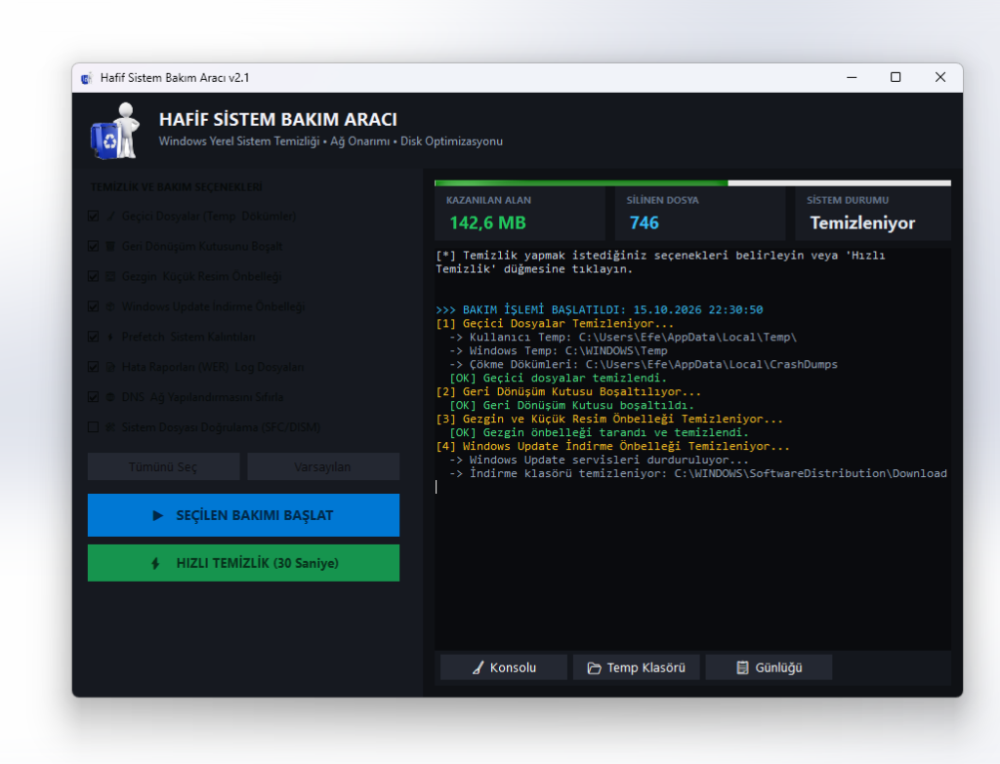

<div align="center">


# Lightweight Windows System Maintenance Tool

**A fast, transparent, and bloatware-free Windows system maintenance & cleaner application.**  
*Built with 100% native Windows tools and C#. Zero third-party dependencies.*

[](LICENSE)
[](https://microsoft.com/windows)
[]()
[-brightgreen.svg)]()
[]()

</div>

---

## 📌 Overview

Most popular PC cleaner tools today have become bloated: bundled with background telemetry daemons, adware, and aggressive registry cleaners that can break Windows components.

**Lightweight Windows System Maintenance Tool** is a minimalist, safe, and portable utility designed to perform essential system cleaning, network repair, and health verification using **only native Windows APIs and built-in system tools**.

- **No installation required:** A single standalone `.exe` (~200 KB).
- **Zero background services:** Runs only when you open it.
- **Zero telemetry:** Completely offline; does not make external network requests.
- **Safe by design:** Preserves Windows security descriptors and Access Control Lists (ACLs) by cleaning folder contents rather than deleting and recreating root directories.

---

## 📸 Screenshot

<div align="center">
  
</div>

---

## ✨ Key Features

| Module | Description | Native Mechanism |
| :--- | :--- | :--- |
| **🧹 Temporary Files** | Cleans user temp (`%TEMP%`), Windows system temp, and local crash dumps without altering directory ACLs. | `System.IO` with safe file attribute normalizer & locked-file bypass |
| **🗑️ Recycle Bin** | Empties the Recycle Bin across all drives silently and without confirmation prompts. | Windows Native `Shell32.dll` (`SHEmptyRecycleBin`) |
| **🖼️ Explorer Cache** | Clears cached thumbnail databases (`thumbcache_*.db`) to reclaim storage and resolve corrupted icon previews. | File enumeration on `%LOCALAPPDATA%\Microsoft\Windows\Explorer` |
| **📦 Windows Update Cache** | Safely purges accumulated downloaded update installers in `SoftwareDistribution\Download` (often reclaiming 5–20 GB). | Prompt-free service management (`net stop wuauserv /y`) and fast kernel batch deletion |
| **⚡ Prefetch** | Removes outdated Windows Prefetch execution files (`C:\Windows\Prefetch`). | Safe file purging |
| **📝 Logs & Error Reports** | Cleans Windows Error Reporting archives (`WER`), CBS installation logs, and setup diagnostics. | Directory scan & cleanup |
| **🌐 Network & DNS Reset** | Flushes DNS resolver cache, reregisters DNS names, resets Winsock catalog, and resets the TCP/IP stack to fix connection lags. | `ipconfig /flushdns`, `ipconfig /registerdns`, `netsh winsock reset`, `netsh int ip reset` |
| **🛠️ Component Verification** | Scans and repairs corrupt Windows system files and component store health. *(Optional deep scan)* | `DISM /Online /Cleanup-Image /RestoreHealth` and `sfc /scannow` |

---

## 📊 Live Dashboard & Performance

- **Real-Time Storage Counter:** Calculates and displays the exact freed space (in MB/GB) and the total number of files purged as cleanup progresses.
- **Multi-Threaded Architecture:** All maintenance tasks run on asynchronous background worker threads; the dark-themed user interface never freezes or stutters.
- **Color-Coded Terminal Console:** Detailed live logs with colored status tags (`[+] Success`, `[*] In Progress`, `[!] Warning`, `[>] Info`).
- **One-Click Log Copy:** Easily copy the full session diagnostic log to your clipboard.

---

## ⚖️ Why This Tool?

| Feature | Lightweight Maintenance Tool | Typical Third-Party Cleaners (e.g., CCleaner) |
| :--- | :---: | :---: |
| **Executable Size** | **~200 KB** | 70 MB – 150 MB |
| **Background Processes** | **0 (None)** | Constant background monitoring services |
| **Telemetry / Data Tracking** | **0% (Completely offline)** | Telemetry & ad tracking enabled by default |
| **Installer / Bloatware** | **None (Single portable .exe)** | Bundled toolbars & companion browser prompts |
| **Registry Cleaning Risks** | **None (No dangerous registry hacks)** | High risk of registry corruption |
| **Source Code** | **100% Open Source** | Proprietary / Closed source |

---

## 🚀 Getting Started

### Option 1: Direct Download
1. Download the latest `SystemMaintenance.exe` from the [Releases](https://github.com/) page.
2. Double-click to run. An automatic UAC prompt will request Administrator privileges.
3. Choose your desired cleaning options or click **"⚡ Quick Cleanup (30s)"**.

### Option 2: Build from Source (1-Click)
No SDK or IDE installation is needed! Every Windows 10 and 11 machine includes the Microsoft C# compiler (`csc.exe`) by default.

1. Clone or download this repository:
   ```bash
   git clone https://github.com/your-username/Windows-Maintenance-Tool.git
   cd Windows-Maintenance-Tool
   ```
2. Double-click `build.bat` (or run it from the command line):
   ```cmd
   build.bat
   ```
3. A freshly compiled `SystemMaintenance.exe` will be ready in 2 seconds!

---

## 🛡️ Safety & Reliability

- **Locked Files:** Files currently in use by active Windows applications are safely ignored without halting the cleanup process.
- **Root Directory Protection:** The tool never deletes root system folders (like `C:\Windows\Temp` or `%TEMP%`). Only child contents are removed, preserving native Windows file security permissions and ownership.
- **Process Guard:** All command executions include hard timeouts (`Process.Kill()`) to prevent background hangs or stalled services.

---

## 📄 License

This project is licensed under the [MIT License](LICENSE) — free for personal and commercial use.
